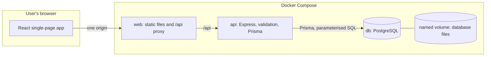
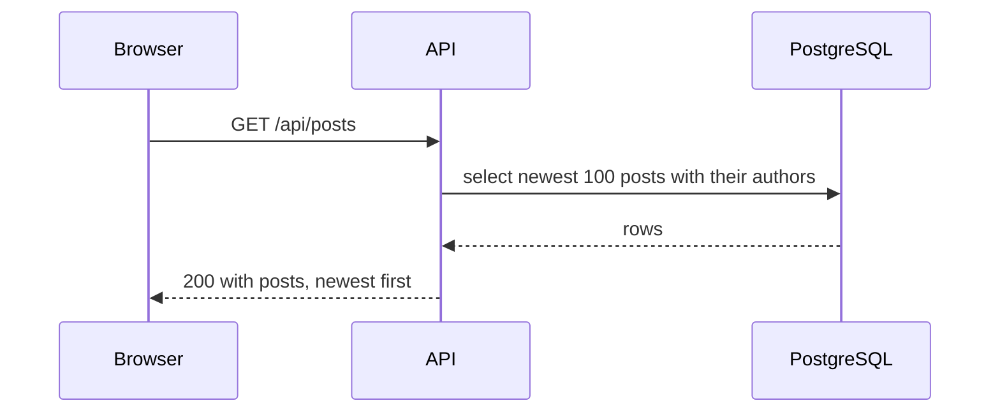
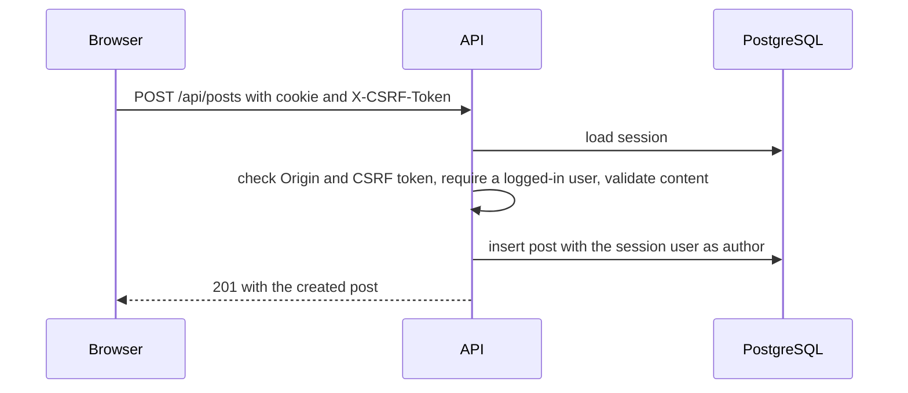

# Chatterbox Architecture

Status: Draft for review · Describes how the pieces fit together. Behaviour is specified in [requirements.md](requirements.md), [api.md](api.md), [database.md](database.md) and [security.md](security.md). Each significant choice is recorded in [adr/](adr/README.md).

## 1. Purpose and context

Chatterbox is a small social feed: visitors read a shared feed, registered users post short text messages. The MVP is demonstrated locally to a small audience through Docker Compose. The design keeps the parts simple and separate so that out-of-scope features (likes, comments, following) can be added later without a rewrite (NFR-X1).

## 2. Components

| Component | Responsibility | Does not do |
|---|---|---|
| **web** | Serves the built React app. Proxies `/api` to the API so the browser sees one origin ([ADR-0006](adr/0006-single-origin-api-proxy.md)) | No business logic |
| **React app** | Screens for registration, login, the feed and composing a post. Calls the API with `fetch` and keeps no secrets | Does not decide who is logged in. The server does |
| **api** | Validates every request, enforces authentication and CSRF rules, applies business rules, talks to PostgreSQL through Prisma | Does not trust anything from the browser |
| **db** | Stores users, posts and sessions. Data lives in a named volume | Not reachable from outside the Docker network by default |

## 3. Runtime topology

| Aspect | Design |
|---|---|
| Services | `web`, `api` and `db` in one `docker-compose.yml` (Stage 2 starts it, Stage 6 finalises it) |
| Exposure | Only `web` publishes a port to the host. `api` and `db` sit on the internal network |
| Startup order | `db` reports healthy, then `api` starts, then `web` (NFR-R2). The API's `/api/health` also reports database connectivity (NFR-R1) |
| Persistence | PostgreSQL data is in a named volume. Restarting or recreating containers keeps it. Deleting the volume deletes the data (FR-06.3, FR-06.4) |
| Configuration | Environment variables only, from `.env`, with `.env.example` as the template (NFR-P2) |
| Local development without Docker for the apps | Run PostgreSQL in a container, run the API and the Vite dev server on the host. Vite proxies `/api` to the API, so the browser still sees one origin |

## 4. Data flows

### 4.1 Reading the feed (visitor or user)

No authentication is needed (FR-04.1). The query is served by the feed index described in `database.md`.

### 4.2 Creating a post

The author always comes from the session and the timestamp is set on the server (FR-05.3, FR-05.4). Registration, login and logout are described in `api.md`, and the login sequence with CSRF and session regeneration is in `security.md`.

## 5. Inside the API

Planned layers (the exact folders are fixed in Stage 2):

| Layer | Responsibility |
|---|---|
| Routes | Map HTTP to a function. Parse and validate input with Zod and send the response |
| Services | Business rules: registering, logging in, creating a post, reading the feed. No HTTP types |
| Data access | Prisma queries. Services call these, routes do not |
| Middleware | Sessions, CSRF and `Origin` checks, authentication, security headers, error handling, request logging |
| Config | Reads and validates environment variables at startup, and refuses to start if they are unsafe (SEC8) |

Rules: routes never touch Prisma directly, services never read `req` or `res`, and one error handler produces every error response in the format from `api.md`. Keeping these layers apart makes the business rules testable without HTTP and keeps each file small (NFR-M1).

## 6. Inside the web app

Planned structure (the exact folders are fixed in Stage 2):

| Part | Responsibility |
|---|---|
| API client | The only code that calls `fetch`. Adds the CSRF token to `POST` requests, refetches it once on a `403 CSRF_INVALID`, and turns error responses into typed errors |
| Auth state | Calls `GET /api/auth/me` on load to learn whether a session exists, and updates after login and logout |
| Screens | Register, login, and the feed with the composer (visible only when logged in) |
| UI states | Every data-driven screen handles loading, empty, error and success (FR-04.4, FR-04.5) |

## 7. Configuration

All variables come from `.env.example`: the PostgreSQL credentials, `DATABASE_URL`, `API_PORT`, `SESSION_SECRET`, `WEB_ORIGIN` and `VITE_API_URL`. With the single-origin design (ADR-0006) `VITE_API_URL` becomes `/api`, which is updated in Stage 2. Secrets are never committed (NFR-S3).

## 8. Cross-cutting concerns

| Concern | Approach | Where |
|---|---|---|
| Security | Server-side sessions, Argon2id, layered CSRF defence, strict validation | `security.md`, ADR-0003, 0004, 0007 |
| Errors | One format, no internal details | `api.md` section 2 |
| Testing | Unit, integration (real PostgreSQL), frontend (React Testing Library) and end-to-end | Stage 2 onward |
| CI | GitHub Actions runs lint, type checks, tests and builds with a PostgreSQL service | S2-4 |
| Schema changes | Version-controlled Prisma migrations | ADR-0005, `database.md` |

## 9. Requirement coverage

| Requirement | Main components | Documented in |
|---|---|---|
| FR-01 Registration | api (routes, services), db (`users`) | `api.md`, `security.md` section 4 |
| FR-02 Login | api, session store, db (`session`) | `security.md` section 5 |
| FR-03 Logout | api, session store | `security.md` section 5.1 |
| FR-04 View feed | web, api, db (`posts`) | section 4.1, `database.md` section 5 |
| FR-05 Create post | web, api, db | section 4.2 |
| FR-06 Persistence | db, named volume, migrations | section 3, `database.md` sections 6 and 7 |
| NFR-S Security | api middleware, config | `security.md` |
| NFR-X Extensibility | layered api, additive migrations, object-shaped list responses | section 10 |
| NFR-R Reliability | health check, startup order | section 3 |

## 10. How the design grows

| Future feature | What changes | What does not |
|---|---|---|
| Likes, comments, following | New tables, new routes and services, new screens | Existing tables, endpoints and screens (see `database.md` section 8) |
| Pagination | Optional query parameters on `GET /api/posts`. The response is already an object | Existing clients |
| More than one API instance | Nothing in the code: sessions are in PostgreSQL (NFR-X2). A load balancer is added in front | Application code |
| A separate origin for the frontend | A new ADR: explicit CORS and credentials handling | The API's logic |

## 11. Decisions made, and decisions deferred

Made: see the [ADR index](adr/README.md). The Node.js version and the package manager and workspaces setup are decided in [ADR-0008](adr/0008-npm-workspaces-and-node-24.md).

Deferred to the stage that has the information to decide:

| Decision | Stage |
|---|---|
| Exact folder layout of both apps | 2 |
| End-to-end test tool | 7 (S7-1). Decided: Playwright, see [ADR-0011](adr/0011-playwright-end-to-end-tests.md) |
| Session pruning interval | 3 (S3-2) |
| Whether migrations run automatically on start or by one documented command | 6 (S6-1) |
| Content Security Policy details | 6 |
