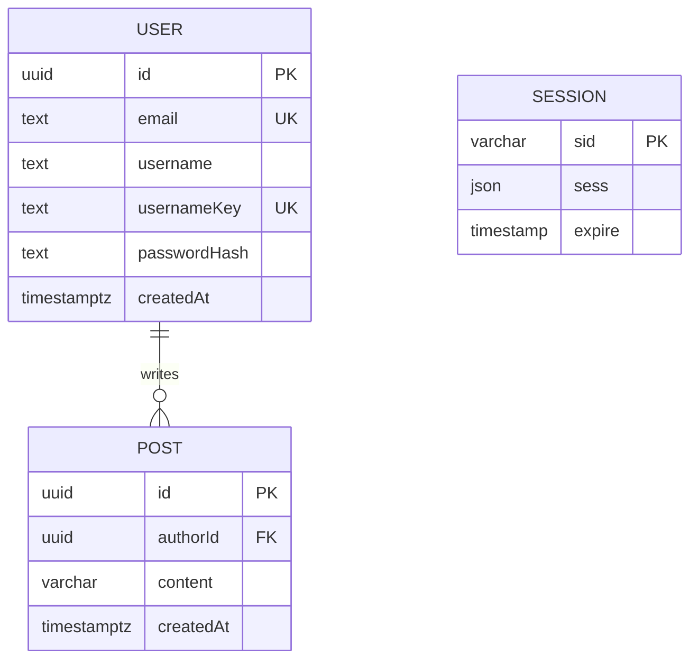

# Chatterbox Database Design

Status: Draft for review · Implements the persistence requirements in [requirements.md](requirements.md) (FR-06, NFR-S6, NFR-X1) and serves the API in [api.md](api.md).

## 1. Overview

- **Database:** PostgreSQL 16, accessed only through Prisma (parameterised queries, NFR-S6).
- **Schema management:** version-controlled Prisma migrations (FR-06.2). The migration folder is committed; applied migrations are never edited.
- **Time:** all timestamps are `timestamptz`, stored in UTC and returned by the API as ISO 8601.
- **Entities:** `User`, `Post`, and a `Session` table owned by the session store.

## 2. Design decisions

| ID | Decision | Reason |
|---|---|---|
| DB1 | Primary keys are UUIDs generated by the database (`gen_random_uuid()`) | Unguessable, no sequence to leak user or post counts, and safe to expose as the API's opaque IDs. The `u_123` / `p_456` IDs in `api.md` are illustrative only |
| DB2 | `email` is stored lower-cased (the API lower-cases before saving) with a unique constraint | Case-insensitive uniqueness without extensions (FR-01.3) |
| DB3 | Usernames keep their original case in `username` for display, and a lower-cased copy in `usernameKey` carries the unique constraint | Case-insensitive uniqueness enforced by the database, without relying on functional indexes or extensions that Prisma handles awkwardly (D2 in requirements) |
| DB4 | Post length is measured in Unicode characters (code points), not UTF-16 units. The API validates this way, and the column is `varchar(280)` as a backstop | An emoji is one character to a user. The database and the API must count identically (D4) |
| DB5 | Deleting a user that has posts is blocked (`ON DELETE RESTRICT`) | Account deletion is out of scope. When it is added it needs its own decision (delete or anonymise posts) |
| DB6 | The session table is modelled in the Prisma schema so migrations create it | One mechanism owns the whole schema, and the app never creates tables at runtime |

## 3. Entity relationship diagram



A user has zero or more posts. A post has exactly one author. `Session` has no foreign key: it is managed by the session store, and the user ID lives inside the session data.

## 4. Tables

### 4.1 `User` (table `users`)

| Column | Type | Null | Constraint | Notes |
|---|---|---|---|---|
| `id` | `uuid` | no | PK, default `gen_random_uuid()` | Returned by the API as `id` |
| `email` | `varchar(254)` | no | unique | Lower-cased and trimmed by the API. Never returned by the API |
| `username` | `varchar(30)` | no | | Display form as entered. 3 to 30 characters, `A-Z a-z 0-9 _` |
| `usernameKey` | `varchar(30)` | no | unique | `lower(username)`, set by the API |
| `passwordHash` | `text` | no | | Argon2id encoded string. Never returned and never logged |
| `createdAt` | `timestamptz` | no | default `now()` | Returned as `createdAt` |

### 4.2 `Post` (table `posts`)

| Column | Type | Null | Constraint | Notes |
|---|---|---|---|---|
| `id` | `uuid` | no | PK, default `gen_random_uuid()` | |
| `authorId` | `uuid` | no | FK to `users.id`, `ON DELETE RESTRICT` | Set from the session, never from the client (FR-05.3) |
| `content` | `varchar(280)` | no | `CHECK (length(btrim(content)) > 0)` | Trimmed by the API before saving. The check rejects blank content even if the API has a bug |
| `createdAt` | `timestamptz` | no | default `now()` | Set by the database or server, never by the client (FR-05.4) |

### 4.3 `Session` (table `session`)

The shape is dictated by the session-store library, chosen in S1-5 and S3-2. For the planned PostgreSQL store:

| Column | Type | Null | Constraint |
|---|---|---|---|
| `sid` | `varchar` | no | PK |
| `sess` | `json` | no | |
| `expire` | `timestamp(6)` | no | index `session_expire_idx` |

The index on `expire` lets the store delete expired sessions efficiently. If the chosen library needs a different layout, this section and the migration change together.

## 5. Indexes

| Index | Table | Columns | Purpose |
|---|---|---|---|
| `users_email_key` | `users` | `email` (unique) | Login lookup and duplicate detection |
| `users_usernameKey_key` | `users` | `usernameKey` (unique) | Duplicate detection |
| `posts_feed_idx` | `posts` | `createdAt DESC, id DESC` | Feed query: newest first, with `id` as a stable tie-breaker when two posts share a timestamp |
| `posts_authorId_idx` | `posts` | `authorId` | Foreign key lookups, and future per-author views |
| `session_expire_idx` | `session` | `expire` | Expired-session cleanup |

The feed query this serves (FR-04):

```sql
SELECT p.id, p.content, p."createdAt", u.id, u.username
FROM posts p
JOIN users u ON u.id = p."authorId"
ORDER BY p."createdAt" DESC, p.id DESC
LIMIT 100;
```

Prisma issues this through its client; the SQL is shown only to document the access pattern the index is built for.

## 6. Migrations

| Rule | Detail |
|---|---|
| Location | `apps/api/prisma/migrations/`, committed to Git |
| Create | `prisma migrate dev --name <description>` during development |
| Apply | `prisma migrate deploy` in Docker and CI. Never `migrate dev` or `db push` against anything but a local scratch database |
| Never edit | Once a migration is merged, fix mistakes with a new migration |
| Hand-written SQL | Allowed inside a migration for things Prisma cannot model (the `CHECK` constraint in 4.2). Mark these with a comment |
| Review | Every migration is read in its PR, since it is the only record of what happened to the data |

The commands above are the standard Prisma ones. The exact `package.json` scripts that wrap them are defined in Stage 3 and will be documented in the README then.

## 7. Persistence and Docker

PostgreSQL data lives in a named Docker volume, defined in Stage 6. Restarting or recreating containers keeps the volume. Deleting the volume deletes all users, posts and sessions. This is documented in the README and verified in S7-1 before any claim that data persists (FR-06.4, FR-06.5).

## 8. Extensibility check (NFR-X1)

The out-of-scope features can be added without changing the meaning of any table above. These are illustrations, **not planned work**:

| Future feature | Would add | Touches existing tables? |
|---|---|---|
| Likes | `likes(userId, postId)` with a composite key | No, only foreign keys to `users` and `posts` |
| Comments | `comments(id, postId, authorId, content, createdAt)` | No |
| Following | `follows(followerId, followeeId)` | No |
| Edit and delete posts | `updatedAt` and `deletedAt` columns on `posts` | Adds nullable columns only |
| Pagination | A cursor on `(createdAt, id)` | No, `posts_feed_idx` already matches it |

## 9. Out of scope

Soft deletes, account deletion, email verification state, roles and permissions, and full-text search. Each needs a new requirement first.
