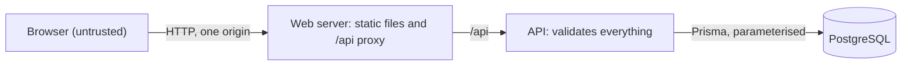
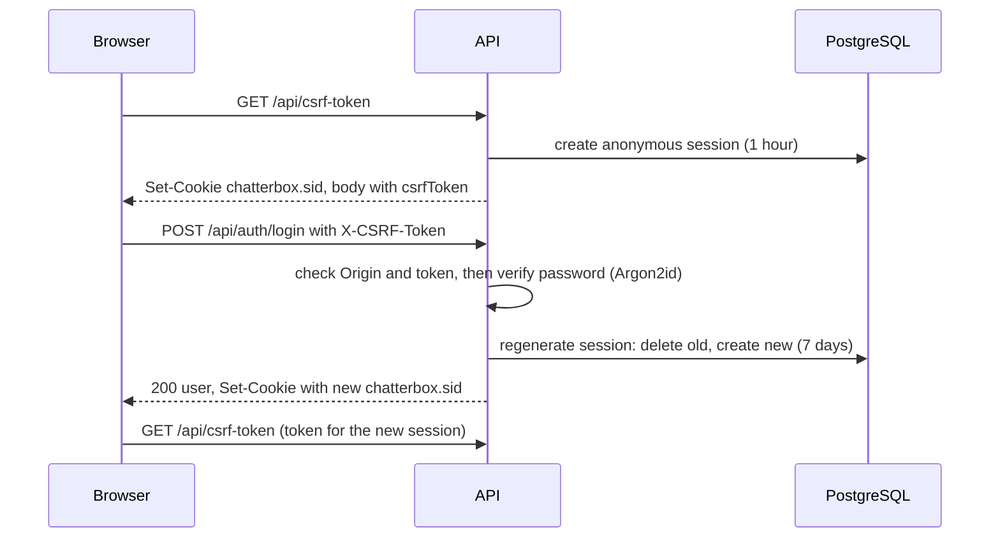

# Chatterbox Authentication, Session and Security Strategy

Status: Draft for review · Implements NFR-S1 to NFR-S6 and FR-01 to FR-03 from [requirements.md](requirements.md), and the behaviour promised in [api.md](api.md). Storage is described in [database.md](database.md).

## 1. Scope and assumptions

| Topic | Assumption |
|---|---|
| Environment | Local demo on a developer machine with Docker Compose, served over HTTP on `localhost`. Production hosting is out of scope, but nothing here needs redesign to harden it (HTTPS, `Secure` cookies) |
| Audience | A small group of known people. This is not a hardened public service |
| Trusted | The host machine, Docker, the application code and the PostgreSQL container |
| Not trusted | Everything from the browser: request bodies, headers, cookies, and any website a logged-in user may visit |
| Attackers considered | A remote anonymous user, and a malicious website visited by a logged-in user |
| Not considered | A compromised host, malicious administrators, large-scale denial of service |

Assets to protect: account credentials (email and password hash), session integrity, and the integrity of posts (nobody can post as someone else).

## 2. Decisions

| ID | Decision | Reason |
|---|---|---|
| SEC1 | The browser talks to **one origin**. The web server serves the static frontend and proxies `/api` to the API (Vite's dev proxy in development, the web container in Docker) | Cookies stay same-origin and no CORS is needed. That removes a whole class of cross-origin mistakes |
| SEC2 | Sessions use `express-session` with `connect-pg-simple`, storing rows in the `session` table defined in `database.md` | Server-side sessions in PostgreSQL as required. The table layout matches the library's default, so `database.md` stands |
| SEC3 | Session cookie: name `chatterbox.sid`, `HttpOnly`, `SameSite=Lax`, `Path=/`, no `Domain`, `Secure` when `NODE_ENV=production` | JavaScript cannot read it, it is host-only, and the browser does not send it on cross-site subrequests |
| SEC4 | Lifetimes: a logged-in session lasts 7 days (absolute, not extended by activity). An anonymous session, created only to hold a CSRF token, lasts 1 hour | Bounded exposure for stolen cookies, and bounded growth of anonymous rows |
| SEC5 | Passwords are hashed with Argon2id using memory 19456 KiB, time cost 2, parallelism 1, a random salt per password, via the `argon2` package | One of the configurations OWASP's Password Storage Cheat Sheet lists for Argon2id. Check it against the current cheat sheet when implementing S4-1. The parameters are stored inside each hash, so they can be raised later |
| SEC6 | CSRF protection is a per-session synchroniser token (sent as `X-CSRF-Token`) plus an `Origin` check, on top of `SameSite=Lax` and JSON-only bodies | Several independent layers, matching decision D6 in `api.md` |
| SEC7 | No rate limiting in the MVP (accepted risk R1 below) | An in-memory limiter would break NFR-X2 (no per-process state), and a shared one needs infrastructure the MVP does not have |
| SEC8 | In production the API refuses to start if `SESSION_SECRET` is missing, still a placeholder, or shorter than 32 characters | A forgotten placeholder secret is a common real-world failure |

## 3. Trust boundaries

- Only the web server's port is exposed to the user. The API and PostgreSQL are reachable only on the internal Docker network. PostgreSQL's port is not published to the host by default (Stage 6 documents how to opt in for debugging).
- Every request from the browser is validated by the API. Nothing the browser sends is trusted, including headers and IDs.

## 4. Password handling

| Rule | Detail |
|---|---|
| Hashing | Argon2id with the parameters in SEC5. Plaintext passwords are never stored, logged or returned (FR-01.4, FR-01.5) |
| Input | 12 to 128 characters (D3). Passwords are never trimmed or otherwise altered. The upper bound stops very long inputs becoming a denial-of-service route against the hasher |
| Verification | `argon2.verify` against the stored hash, which compares in constant time |
| Rehash | If a login succeeds and the stored hash uses older parameters than SEC5, the hash is replaced on that login |
| Unknown email | The API still verifies the supplied password against a **dummy Argon2id hash** with the same parameters, created once at startup from random data. This keeps the work done the same for an unknown email and a wrong password (FR-02.4). The tests check that this path runs, rather than measuring time, which is unreliable |
| Responses | Login failure always returns the identical `INVALID_CREDENTIALS` body |

## 5. Sessions and cookies

### 5.1 Lifecycle

| Event | What happens |
|---|---|
| Visitor loads the app | `GET /auth/me` returns 401. The client then calls `GET /csrf-token`, which creates an anonymous session (1 hour) holding a random CSRF token |
| Register | Creates the account only. The session does not change |
| Login | Validate input, verify the password (section 4), then **regenerate the session**: the old session is deleted and a new one with a new ID is created holding the user ID and a new CSRF token, with a 7-day lifetime (FR-02.2, FR-02.3). The client fetches the new token afterwards |
| Authenticated request | The signed cookie identifies the session in PostgreSQL and the user ID comes from it, never from the request body |
| Logout | The session is destroyed in PostgreSQL and the cookie is cleared, so the old cookie authorises nothing (FR-03.2, FR-03.3) |
| Expiry | The store deletes expired rows periodically. The interval is chosen in S3-2 |

### 5.2 Cookie attributes

| Attribute | Value | Why |
|---|---|---|
| Name | `chatterbox.sid` | Avoids the default name that reveals the framework |
| `HttpOnly` | yes | Scripts cannot read the cookie, which limits the damage of any XSS |
| `Secure` | yes in production, no on local `http://localhost` | Browsers do not send `Secure` cookies over plain HTTP in most setups. Production must use HTTPS and the API must trust the proxy |
| `SameSite` | `Lax` | Not sent on cross-site POSTs or subrequests. `Strict` was considered and adds little here, since CSRF is also covered by the token and `Origin` check |
| `Domain` | not set | Host-only cookie, not shared with subdomains |
| `Path` | `/` | |
| `Max-Age` | 7 days for logged-in sessions, 1 hour for anonymous | See SEC4 |

The cookie value is signed with `SESSION_SECRET`. It carries only the session ID, never user data.

### 5.3 Other session rules
- Many sessions per user are allowed (several browsers). There is no "log out everywhere" in the MVP.
- The session ID is never placed in a URL.
- `Cache-Control: no-store` is sent on `/auth/*` responses and on `GET /csrf-token`.

## 6. CSRF protection

Layers, all applied to every `POST`:

| Layer | Rule | Failure |
|---|---|---|
| `Content-Type` | Must be `application/json`, which a plain cross-site HTML form cannot send | `415 UNSUPPORTED_MEDIA_TYPE` |
| `Origin` | If an `Origin` header is present it must equal `WEB_ORIGIN` | `403 CSRF_INVALID` |
| Token | `X-CSRF-Token` must equal the token stored in the session, compared in constant time | `403 CSRF_INVALID` |
| Cookie | `SameSite=Lax` (section 5.2) | The cookie is not sent |

Details:
- The token is 32 random bytes, base64url encoded, created with the session and replaced when the session is regenerated.
- `GET`, `HEAD` and `OPTIONS` never change state, so they need no token.
- Requests with no `Origin` header (for example command-line clients) still need a valid token.
- **Client behaviour:** on a `403 CSRF_INVALID`, fetch a new token and retry once. This covers expired sessions. A logout with a stale token is then treated as already logged out.

## 7. Cross-origin behaviour

- With SEC1 the browser only makes same-origin requests, so the API sends **no CORS headers** and browsers block cross-origin reads by default.
- `WEB_ORIGIN` (already in `.env.example`) is used for the `Origin` check, not for CORS.
- If a second origin is ever needed, that is a new decision recorded as an ADR, with explicit allowed origins and credentials handling.

## 8. Input validation, errors and logging

| Topic | Rule |
|---|---|
| Validation | Every body is validated with a strict Zod schema (unknown fields rejected, per `api.md`). Query and path parameters are validated the same way (NFR-S1) |
| Body size | JSON bodies are limited to 10 KB. An oversized body returns `400 VALIDATION_ERROR` |
| Database | Prisma only, with no raw SQL built from input (NFR-S6). Duplicates are detected from the database's unique constraint, not a check-then-insert, so races give a `409` and not a server error |
| Output | The shared error format in `api.md`. A central handler maps validation, conflict and auth errors, and returns a generic `INTERNAL_ERROR` for anything unexpected, with no stack trace, SQL or file path (NFR-S4) |
| Logging | Log method, path, status and duration with a request ID. Never log passwords, cookies, CSRF tokens, request bodies of auth endpoints or full connection strings. Stack traces go to the server log only |
| XSS | React escapes text by default. Post content is rendered as text, and `dangerouslySetInnerHTML` is not used |

## 9. Secrets and configuration

| Rule | Detail |
|---|---|
| Source | All secrets and configuration come from environment variables (NFR-P2). `.env` is git-ignored and `.env.example` holds placeholders only (NFR-S3) |
| `SESSION_SECRET` | At least 32 characters of random data (`openssl rand -hex 32`). SEC8 enforces this in production |
| Rotation | `express-session` accepts a list of secrets. Putting the new secret first and keeping the old one allows rotation without logging everyone out |
| Database credentials | Provided through `DATABASE_URL` and the `POSTGRES_*` variables. Never logged |
| Dependencies | `npm audit` is run in CI and reviewed in S7-2. Dependency versions are pinned by the lockfile |

## 10. Browser hardening

Applied by the API (via `helmet` defaults) and by the web server for static files:

- `X-Content-Type-Options: nosniff`, no `X-Powered-By` header.
- Clickjacking protection: `frame-ancestors 'none'` in the Content-Security-Policy, with `X-Frame-Options: DENY` as a fallback.
- A Content-Security-Policy for the static frontend limited to its own origin (`default-src 'self'`). The exact policy is set in Stage 6 once the production build's needs are known.
- `Referrer-Policy: no-referrer`.

## 11. Threats and mitigations

| Threat | Mitigation | Status |
|---|---|---|
| Stolen password database | Argon2id, per-password salt, no plaintext | Mitigated |
| Online password guessing | Argon2id cost, 12-character minimum | **Partly mitigated** (R1) |
| Session fixation | Session regenerated at login | Mitigated |
| Stolen session cookie via script | `HttpOnly`, React output escaping, CSP | Mitigated |
| Cross-site request forgery | Token, `Origin` check, `SameSite=Lax`, JSON-only | Mitigated |
| Account enumeration at login | Identical error body, equal hashing work | Mitigated |
| Account enumeration at registration | A duplicate email returns `409` | **Accepted** (R2) |
| SQL injection | Prisma parameterised queries, strict validation | Mitigated |
| Posting as another user | Author taken from the session, `author` rejected as an unknown field | Mitigated |
| Information leaks in errors | Central error handler, generic 500 | Mitigated |
| Clickjacking | `frame-ancestors 'none'` | Mitigated |
| Secrets committed to Git | `.gitignore`, `.env.example` placeholders, review checks | Mitigated, re-checked in S7-2 |
| Traffic interception | Needs HTTPS. The local demo uses HTTP on localhost | **Accepted for the demo** (R3) |
| Growth of anonymous session rows | 1-hour expiry and periodic pruning | **Partly mitigated** (R1) |
| Vulnerable dependencies | `npm audit` in CI, reviewed in S7-2 | Mitigated, ongoing |

## 12. Accepted risks and known limitations

| ID | Risk | Why accepted | Future work |
|---|---|---|---|
| R1 | No rate limiting. Someone could guess passwords or create many anonymous sessions or accounts | Demo with a small known audience. A correct limiter needs shared state | Per-IP and per-account limits on login, register and `GET /csrf-token`, once a shared store exists |
| R2 | Registering reveals that an email address already has an account | Cannot be hidden without email verification, which is out of scope | Email verification flow |
| R3 | The local demo runs over HTTP | There is no production deployment in the MVP | Terminate HTTPS at a proxy, set `Secure` and trust the proxy |
| R4 | No password reset, no multi-factor authentication, no "log out everywhere" | Out of scope | New requirements |

## 13. Security test cases

These are the scenarios S4-1, S4-2, S5-1 and S7-2 must cover.

| ID | Scenario | Expected |
|---|---|---|
| SEC-T1 | Register, then inspect the stored `users` row | `passwordHash` starts with `$argon2id$`. No plaintext appears anywhere (FR-01.4) |
| SEC-T2 | Register and login responses | Contain no `email` and no hash fields (FR-01.5) |
| SEC-T3 | Login with a wrong password and with an unknown email | Identical status and body (FR-02.4) |
| SEC-T4 | Login with an unknown email | The dummy-hash verification path runs (checked with a spy, not timing) |
| SEC-T5 | Successful login | The `Set-Cookie` has `HttpOnly` and `SameSite=Lax`, and the session ID differs from before login (FR-02.3) |
| SEC-T6 | Logout, then replay the old cookie on `POST /posts` | 401 (FR-03.3) |
| SEC-T7 | `POST` without `X-CSRF-Token`, and with a wrong token | 403 `CSRF_INVALID` |
| SEC-T8 | `POST` with an `Origin` that differs from `WEB_ORIGIN` | 403 `CSRF_INVALID` |
| SEC-T9 | `POST /posts` with an `author` field | 400 `VALIDATION_ERROR` |
| SEC-T10 | `POST /posts` without a session | 401 (FR-05.1) |
| SEC-T11 | Force a server error | Response is the generic `INTERNAL_ERROR`, with no stack trace or SQL (NFR-S4) |
| SEC-T12 | Start the API with `NODE_ENV=production` and a placeholder or short `SESSION_SECRET` | The process exits with an error (SEC8) |
| SEC-T13 | Register the same username with different capitalisation | 409 (FR-01.3) |
| SEC-T14 | Search the repository for committed secrets and `.env` files | None found (NFR-S3) |

## 14. Follow-ups for other tasks

These change files outside this document, so they are listed here and **not** done in this task:

- **S2-3 (Docker and `.env.example`):** with SEC1 the frontend calls `/api` on its own origin, so `VITE_API_URL` becomes `/api`, and the web container proxies `/api` to the API.
- **S1-5 (ADRs):** record SEC1 (same origin), SEC2 (session library) and SEC5 (Argon2id parameters) as ADRs.
- **S3-2:** choose the session pruning interval and implement the two session lifetimes in SEC4.
- **S6-1:** unpublished PostgreSQL port, the production secret check (SEC8) and the CSP.
